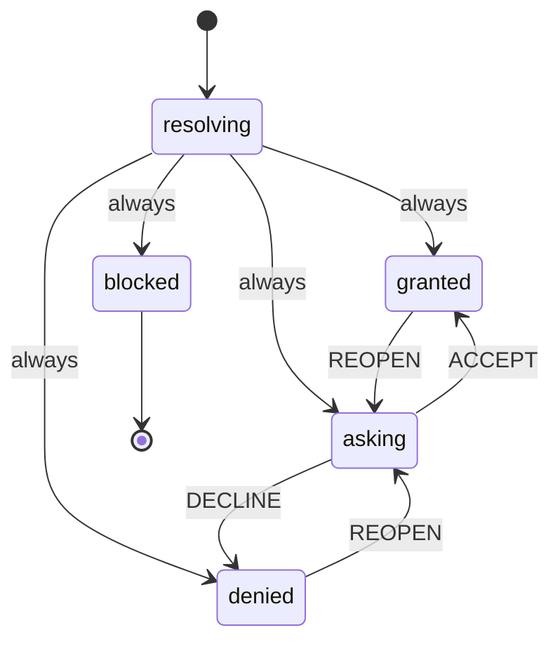

<!-- generated:start -->
<!-- Written by `cf-saas-blocks sync` from feature.json and the source. Edits here are lost. -->

# Consent (`consent`)

The cookie consent banner and its state machine, the cookie settings button, and the analytics tracker that waits for consent. Honours Do Not Track and Global Privacy Control.

- Kind: feature, required; it can't be removed
- Depends on: none
- Used by: none
- Bindings: none
- Vars: none
- Secrets: none
- Also owns: none
- Feeds: none
- Routes: none
- Services: none
- Errors: none
- Events: none
- Machines: `components/consent.machine.ts`. Diagrams under Machines, from `bun run machines:print`.
<!-- generated:end -->

<!-- machines:start -->

## Machines

Written by `bun run machines:print`. `bun run test` fails when a diagram is out of date.

### consent

Source: `src/features/consent/components/consent.machine.ts`

<!-- machines:end -->

## Decisions

<!-- Newest first, one line each: - YYYY-MM-DD — <decision>. Why: <reason>. (<commit sha or PR URL>) -->

- 2026-11-24 — Allowing analytics sets an `aid` cookie with a random id; declining clears it. Why: browser events from a signed-out visitor each counted as a new person; the id is random and only exists after consent.
- 2026-11-24 — Consent stays a feature outside core and owns the analytics tracker and the cookie settings button. Why: it has components and logic of its own (its machine), and both pieces wait on it.
- 2026-11-24 — Consent is a machine: Do Not Track or Global Privacy Control blocks it with no banner, a saved cookie decides next, and a first visit asks. Why: each outcome is a state with a unit test and an e2e path spec.
- 2026-11-24 — The choice is saved with `document.cookie`. Why: the Cookie Store API is not in every browser yet.
- 2026-11-24 — Consent gates browser events only; server events from signed-in flows do not wait for it. Why: those record what the server did, not what the browser saw.

## History

<!-- Newest first, one line each: - YYYY-MM-DD — <what changed>. (<commit sha or PR URL>) -->

- 2026-11-27 — Created from create-tanstack-cf-saas 0.1.0.
