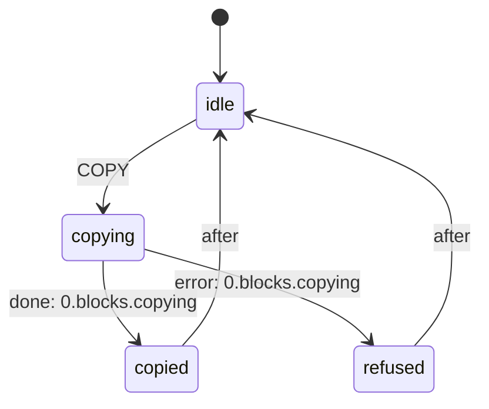

<!-- generated:start -->
<!-- Written by `software-factory-blocks sync` from feature.json and the source. Edits here are lost. -->

# Home (`home`)

The home page and the /api/health check.

- Kind: feature, required; it can't be removed
- Depends on: none
- Used by: none
- Bindings: none
- Vars: none
- Secrets: none
- Also owns: none
- Feeds: `src/gen/nav.ts`, `src/gen/routes.ts`
- Routes: `/`, `/api/health`
- Services: none
- Errors: none
- Events: none
- Machines: `components/blocks.machine.ts`. Diagrams under Machines, from `bun run machines:print`.
<!-- generated:end -->

<!-- machines:start -->

## Machines

Written by `bun run machines:print`. `bun run test` fails when a diagram is out of date.

### blocks

Source: `src/features/home/components/blocks.machine.ts`

<!-- machines:end -->

## Decisions

<!-- Newest first, one line each: - YYYY-MM-DD — <decision>. Why: <reason>. (<commit sha or PR URL>) -->

- 2026-11-28 — The picker's rules (what a block needs, the CLI's feature order) are copied into `lib/blocks.ts`, not read from the template. Why: the docs site imports nothing from `templates/`; when a block's `requires` changes there, change it here.
- 2026-11-28 — The film is one file in `public/home/`, turned dark by a CSS filter (invert, then turn the hue half way) instead of a second dark file. Why: the paper goes dark, the crate stays orange, and visitors download one 2 MB film, not two.
- 2026-11-27 — The home page's size budget rises from 180 kB to 240 kB for Fumadocs' `HomeLayout`. Why: it is the same nav, search and theme code `/docs` loads, so a visitor fetches it once (https://github.com/SeanningTatum/software-factory/pull/72).
- 2026-11-24 — The production CSP adds `frame-src https://challenges.cloudflare.com` for the Turnstile widget (see auth). Why: `default-src 'self'` would block its frame; its script needs no source because `'strict-dynamic'` trusts scripts our nonced code adds.
- 2026-11-24 — Server functions refuse cross-site calls: `src/start.ts` adds Start's `csrf` middleware (`src/app/middleware.ts`), filtered to server functions. Why: Start warned in dev that they had no CSRF check; API routes (`/api/auth/*`, `/api/events`, Stripe webhooks) are not server functions and stay open.
- 2026-11-24 — `/api/health` answers 503 with what is wrong unless every required setting is set, `APP_URL` is the origin being served and D1 (when the project has a `DB` binding) answers `SELECT 1`. Why: the deploy smoke test passed a deploy with no secrets or a localhost `APP_URL`; it reads the binding through `core/lib` so a project without db still works.
- 2026-11-24 — Feature routes mount through generated virtual file routes: `src/gen/routes.ts` mounts each feature's `routes/` at the URL root, and `src/routes/` holds only `__root.tsx`. Why: adding or removing a feature adds or removes its pages, with no route folders to edit by hand.

## History

<!-- Newest first, one line each: - YYYY-MM-DD — <what changed>. (<commit sha or PR URL>) -->

- 2026-11-28 — The home page is the brand's first page: a film of a crate crossing a factory, a block picker that writes the create command, the picked blocks drawn as a stack of plates, the gates and the CLI's other commands.
- 2026-11-27 — The heading reads "Software Factory for Cloudflare Workers" and the intro names the CLI and the Claude Code harness, after the project was renamed.
- 2026-11-27 — The home page sits in Fumadocs' `HomeLayout`, whose nav links to the docs.
- 2026-11-27 — The home page introduces the docs and links to /docs.

- 2026-11-27 — The health spec expects `database` to be "up" with a `drizzle.config.ts` and absent without one, so a lost binding fails it.
- 2026-11-27 — Created from create-tanstack-cf-saas 0.1.0.
