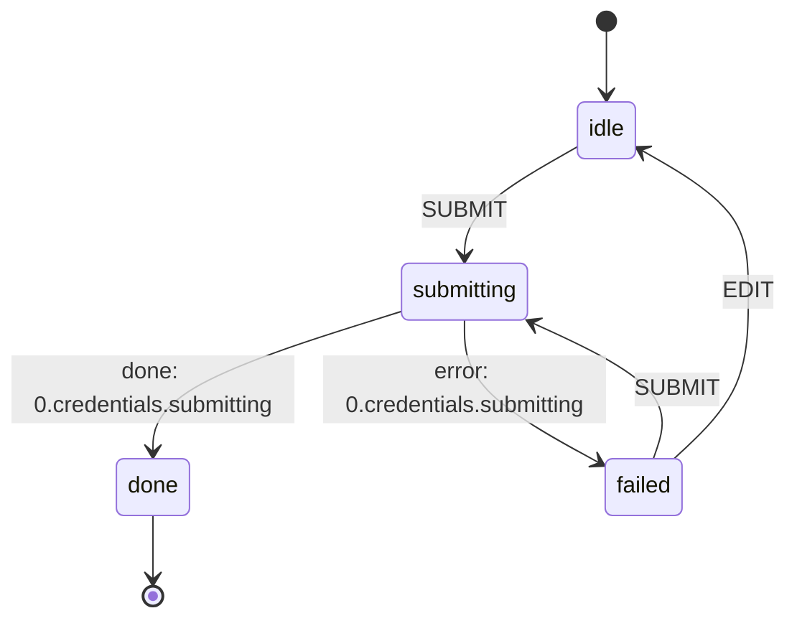

<!-- generated:start -->
<!-- Written by `cf-saas-blocks sync` from feature.json and the source. Edits here are lost. -->

# Auth (`auth`)

Better Auth with email and password (GitHub when keys are set), sessions in D1, rate-limited sign-in and sign-up.

- Kind: feature, optional; `cf-saas-blocks remove auth` takes it out
- Depends on: [db](../core/db/TIMELINE.md)
- Used by: [billing](../billing/TIMELINE.md), [uploads](../uploads/TIMELINE.md)
- Bindings: `AUTH_LIMITER` (ratelimit)
- Vars: `APP_URL` (required), `GITHUB_CLIENT_ID`, `TRUSTED_ORIGINS`
- Secrets: `BETTER_AUTH_SECRET` (required), `GITHUB_CLIENT_SECRET`
- Also owns: none
- Feeds: `src/gen/layers.ts`, `src/gen/errors.ts`, `src/gen/events.ts`, `src/gen/nav.ts`, `src/gen/viewer.ts`, `src/gen/routes.ts`
- Routes: `/api/auth/$`, `/dashboard`, `/login`, `/signup`
- Services: `Auth`, `AuthRateLimiter`
- Errors: `AuthServiceError`
- Events: `sign_in_failed`, `sign_in_succeeded`, `sign_up_completed`, `signed_out`
- Machines: `components/credentials.machine.ts`. Diagrams under Machines, from `bun run machines:print`.
<!-- generated:end -->

<!-- machines:start -->

## Machines

Written by `bun run machines:print`. `bun run test` fails when a diagram is out of date.

### credentials

Source: `src/features/auth/components/credentials.machine.ts`

<!-- machines:end -->

## Decisions

<!-- Newest first, one line each: - YYYY-MM-DD — <decision>. Why: <reason>. (<commit sha or PR URL>) -->

- 2026-11-24 — The sign-in and sign-up form uses `method="post"`, and its button waits for hydration. Why: a submit before React loaded put the password in the URL, the browser history and the server log.
- 2026-11-24 — Without `BETTER_AUTH_SECRET` (32+ characters), `APP_URL` or the `DB` binding, Auth degrades: everyone is signed out and `/api/auth` answers 503 with `NotConfigured` naming the setting. Why: the rest of the app keeps working.
- 2026-11-24 — Better Auth's own rate limit is off; the `AUTH_LIMITER` binding limits sign-in, sign-up and forget-password per IP and path, and a limiter outage lets requests through. Why: only password paths need it, and an outage must not lock everyone out.
- 2026-11-24 — Auth analytics events come from Better Auth's response on the server, not from the form. Why: only the server knows for certain what happened.
- 2026-11-24 — Other features extend Better Auth through their `auth-plugins.ts`, gathered into `src/gen/auth-plugins.ts`; plugins queue events and warnings that flush with the request. Why: billing adds Stripe without auth importing billing.
- 2026-11-24 — `ensureSignedIn` only decides what a page renders; server functions check the session themselves. Why: a redirect is not a security check.

## History

<!-- Newest first, one line each: - YYYY-MM-DD — <what changed>. (<commit sha or PR URL>) -->

- 2026-11-24 — `APP_URL` defaults to `http://localhost:3001`, so the website runs beside the template on 3000.
- 2026-11-24 — Auth calls run through `outsideCall` and the rate limiter binding is read with `binding`, both from `core/lib`; imports db, analytics and ui from `src/features/core/`.
- 2026-11-24 — The path specs wait for an enabled button, give each test its own visitor IP so the sign-up limiter does not trip on a second run, and wait for sign-out before signing up again; `reaches submitting` now signs up for real. Added an SSR test for the form.
- 2026-11-24 — Created from create-tanstack-cf-saas 0.1.0.
