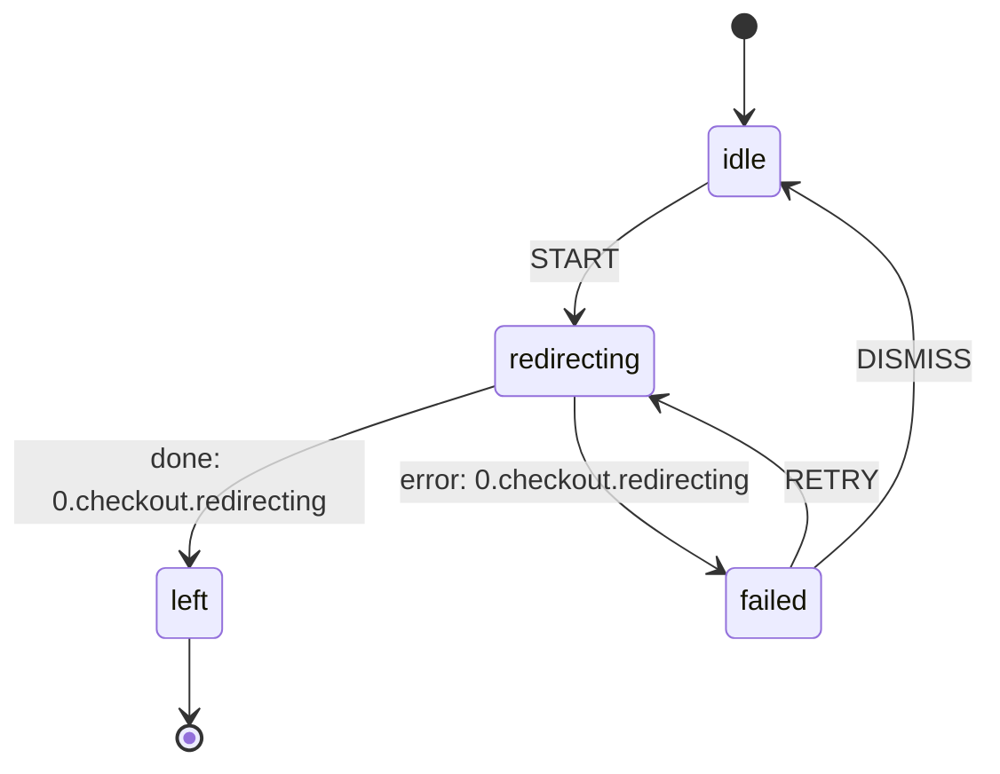
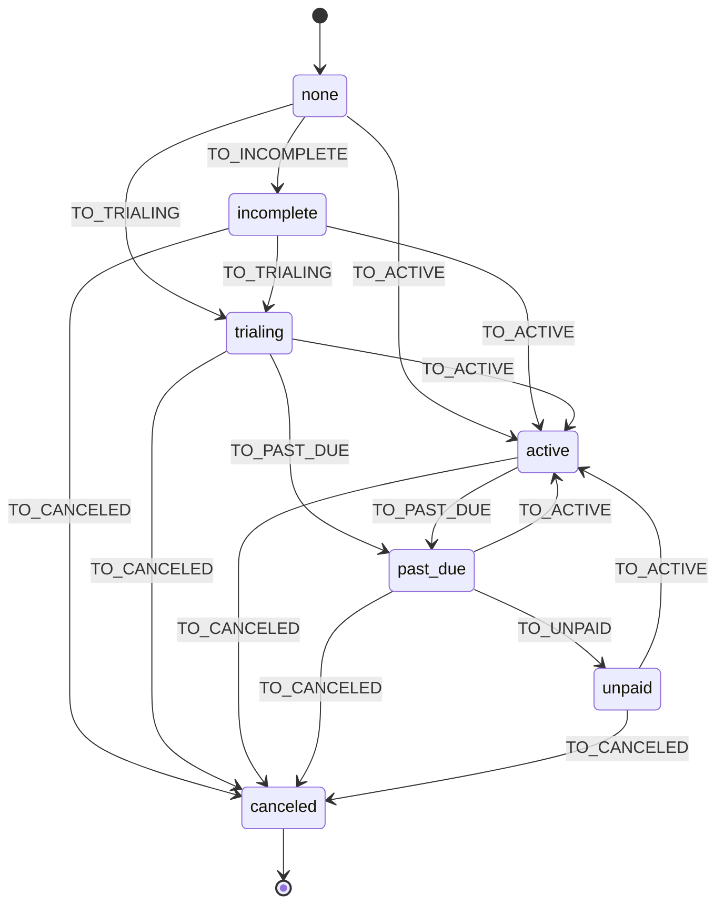

<!-- generated:start -->
<!-- Written by `cf-saas-blocks sync` from feature.json and the source. Edits here are lost. -->

# Billing (`billing`)

Stripe subscriptions through Better Auth's Stripe plugin: checkout, customer portal and webhooks.

- Kind: feature, optional; `cf-saas-blocks remove billing` takes it out
- Depends on: [auth](../auth/TIMELINE.md)
- Used by: none
- Bindings: none
- Vars: `STRIPE_PRICE_PRO` (required)
- Secrets: `STRIPE_SECRET_KEY` (required), `STRIPE_WEBHOOK_SECRET` (required)
- Also owns: none
- Feeds: `src/gen/layers.ts`, `src/gen/events.ts`, `src/gen/nav.ts`, `src/gen/auth-plugins.ts`, `src/gen/routes.ts`
- Routes: `/billing`
- Services: `Billing`
- Errors: none
- Events: `checkout_started`, `subscription_activated`, `subscription_canceled`
- Machines: `components/checkout.machine.ts`, `machines/subscription.machine.ts`. Diagrams under Machines, from `bun run machines:print`.
<!-- generated:end -->

<!-- machines:start -->

## Machines

Written by `bun run machines:print`. `bun run test` fails when a diagram is out of date.

### checkout

Source: `src/features/billing/components/checkout.machine.ts`

### subscription

Source: `src/features/billing/machines/subscription.machine.ts`

<!-- machines:end -->

## Decisions

<!-- Newest first, one line each: - YYYY-MM-DD — <decision>. Why: <reason>. (<commit sha or PR URL>) -->

- 2026-11-24 — The subscription update hook re-reads the subscription from Stripe and writes Stripe's status back when the row differs. Why: the Stripe plugin copies each event's status without comparing times, so a late or retried update (more likely with `stripe-webhook-retry`) could turn a canceled subscription back to active.
- 2026-11-24 — `BillingState.entitled` is the one place that decides paid access (active or trialing); `plan` is the plan the user gets now, and `status` stays set while there is a subscription to manage. Why: the page treated past_due as Pro while `isEntitled` said no.
- 2026-11-24 — A Stripe webhook during which Better Auth logged an error answers 500 (`stripe-webhook-retry` plugin). Why: the Stripe plugin catches D1 errors and answers 200, so Stripe never retried and the change was lost; its handlers write by id, so a retry is safe.
- 2026-11-24 — The unexpected-change check reads the old status from the event's `previous_attributes`. Why: the plugin passes the row after it was written, so the old check compared a status with itself and never fired.
- 2026-11-24 — Without `STRIPE_SECRET_KEY` and `STRIPE_WEBHOOK_SECRET` the Stripe plugin is left out and `/billing` says what is missing. Why: the rest of the app works without Stripe.
- 2026-11-24 — The subscription lifecycle is a machine, and the `onSubscriptionUpdate` webhook handler checks each status change against it and logs the ones it did not expect. Why: Stripe stays the source of truth, so an odd change earns a warning, not a refusal.
- 2026-11-24 — A plan exists only when its Stripe price id is set (`STRIPE_PRICE_PRO`). Why: a plan without a price is left out, not broken.
- 2026-11-24 — The upgrade and manage button is the checkout machine; leaving for Stripe ends it, and a failure can be retried or dismissed. Why: every outcome of the button is a tested state.

## History

<!-- Newest first, one line each: - YYYY-MM-DD — <what changed>. (<commit sha or PR URL>) -->

- 2026-11-24 — The paths spec sets its made-up client address with `asVisitor(page)`, which leaves Turnstile's requests alone.
- 2026-11-24 — `e2e/billing.route.spec.ts` covers /billing: the plan page with an axe scan, and the redirect to /login when signed out.
- 2026-11-24 — Checkout and subscription events carry the user's id (the subscription's `referenceId` on webhooks), so they reach the audit log and analytics under the right user.
- 2026-11-24 — `metric` in `events.ts`: checkouts that become paid subscriptions, less cancellations.
- 2026-11-24 — `Billing.stateFor` reads every live row and takes the first entitled one, else the first; it used to take an arbitrary row with `.limit(1)`, so `past_due` beside `active` could hide the paid plan.
- 2026-11-24 — Indexed `subscription.reference_id`, `stripe_subscription_id` and `stripe_customer_id` in migration `0001_indexes`.
- 2026-11-24 — Imports db and ui from `src/features/core/`.
- 2026-11-24 — The checkout spec waits for an enabled button and the dashboard before it goes on, and the Stripe Checkout test skips, with the reason, when the page shows the setup hint.
- 2026-11-24 — Created from create-tanstack-cf-saas 0.1.0.
