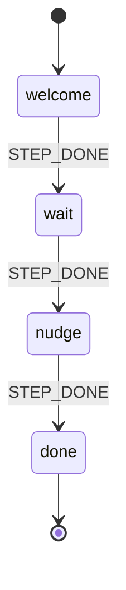

<!-- generated:start -->
<!-- Written by `cf-saas-blocks sync` from feature.json and the source. Edits here are lost. -->

# Workflows (`workflows`)

A durable onboarding Cloudflare Workflow whose steps are Effects, in the order a state machine sets.

- Kind: feature, optional; `cf-saas-blocks remove workflows` takes it out
- Depends on: none
- Used by: none
- Bindings: `ONBOARDING_WORKFLOW` (workflow)
- Vars: none
- Secrets: none
- Also owns: none
- Feeds: `src/gen/layers.ts`, `src/gen/errors.ts`, `src/gen/events.ts`, `src/gen/workflows.ts`
- Routes: none
- Services: `Onboarding`
- Errors: `WorkflowError`
- Events: `onboarding_completed`, `onboarding_started`
- Machines: `machines/onboarding.machine.ts`. Diagrams under Machines, from `bun run machines:print`.
<!-- generated:end -->

<!-- machines:start -->

## Machines

Written by `bun run machines:print`. `bun run test` fails when a diagram is out of date.

### onboarding

Source: `src/features/workflows/machines/onboarding.machine.ts`

<!-- machines:end -->

## Decisions

<!-- Newest first, one line each: - YYYY-MM-DD — <decision>. Why: <reason>. (<commit sha or PR URL>) -->

- 2026-11-24 — No HTTP trigger and no `WORKFLOWS_TRIGGER_TOKEN`: server code starts and reads runs through the `Onboarding` service, which takes the `ONBOARDING_WORKFLOW` binding from the Worker's env. Why: the binding is already typed in the env, so a public endpoint behind a token was needless. Nothing calls `Onboarding.start` out of the box; call it from your own server code, for example after sign-up.
- 2026-11-24 — Onboarding runs have the id `onboarding-<userId>`, and starting one that exists returns it; user ids are letters, digits, `-` and `_`, up to 64. Why: a retried trigger started a second run with duplicate steps and events.
- 2026-11-24 — The onboarding step order comes from `machines/onboarding.machine.ts`, and a test checks that `runOnboarding` follows it. Why: the diagram is always what production runs.
- 2026-11-24 — Each step runs in a fresh runtime whose request id is the workflow instance id. Why: every log line from one run shares an id.
- 2026-11-24 — Without the `ONBOARDING_WORKFLOW` binding the service fails with `NotConfigured`. Why: the rest of the app keeps working.

## History

<!-- Newest first, one line each: - YYYY-MM-DD — <what changed>. (<commit sha or PR URL>) -->

- 2026-11-25 — Dropped the stale decision that an HTTP trigger needs `WORKFLOWS_TRIGGER_TOKEN`; there is no HTTP trigger and no token. (https://github.com/SeanningTatum/tanstack-cf-saas-starter/pull/16)
- 2026-11-24 — `metric` in `events.ts`: the share of started onboardings that finish.
- 2026-11-24 — Each step disposes its runtime even when it fails, so queued analytics are still sent.
- 2026-11-24 — Workflow calls run through `outsideCall` and the binding is read with `binding`, both from `core/lib`; imports analytics from `src/features/core/`.
- 2026-11-24 — Created from create-tanstack-cf-saas 0.1.0.
