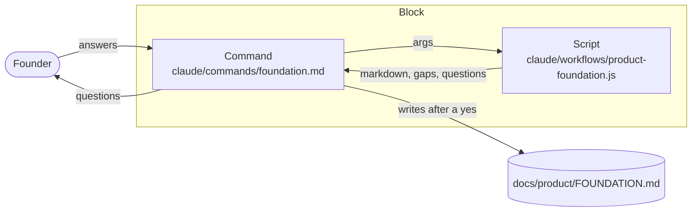
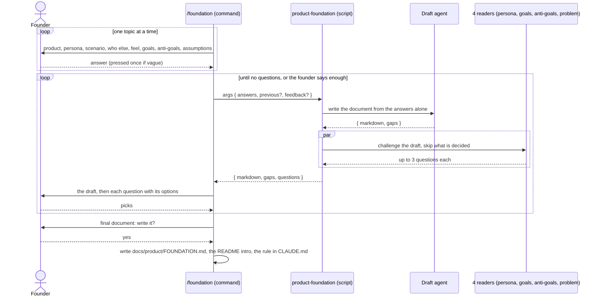
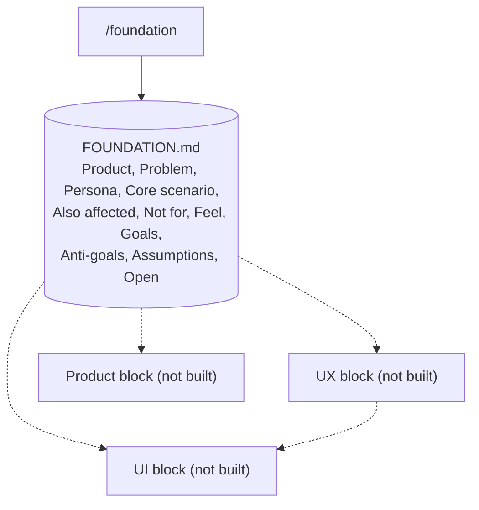

# Workflow blocks

How the Claude workflows that ship in `claude/` fit together. The rules for adding one are in
`claude/README.md`; this page draws them.

## A block

A block is a command and a script. The command talks to the human; the script runs the agents. A
script cannot pause for a person, so every stop is in the command.



## The foundation block, step by step



## How later blocks build on it

Only the foundation block exists. The others are the plan.



## What goes in and what comes out

In, as the workflow's `args`. Only `answers` is checked; the rest is free text.

```json
{
  "answers": {
    "product": "Chaser (a working name): it sends polite payment reminders for freelance designers...",
    "persona": "A freelance brand or web designer working alone, 3 to 10 active clients...",
    "scenario": "On a Monday morning at their desk, a designer sees an invoice is two weeks overdue...",
    "alsoAffected": "The designer's clients, who get the reminders. They should feel nudged, not accused.",
    "feel": "Calm, friendly, a bit dry. Never pushy, corporate or cute.",
    "goals": "50 paying users by the end of March 2027. Grow fast after that.",
    "earns": "",
    "antiGoals": "We will not build invoicing itself. No mobile app.",
    "assumptions": "Designers will let a tool email their clients in their name."
  },
  "previous": "# Product foundation ... (the last draft, on a second round)",
  "feedback": [
    {
      "question": "What should goal 2 say?",
      "answer": "$5,000 monthly revenue by end of December 2027"
    }
  ]
}
```

Out. Each agent's reply is held to a JSON Schema (`DRAFT` and `QUESTIONS` in the script), so a
malformed reply is retried, not passed on. `gaps` repeats the document's Open section, line for line.

```json
{
  "markdown": "# Product foundation\n\n## Product\nChaser, a working name and not fixed, sends polite payment reminders...",
  "gaps": [
    "Goals: Earns by is empty. Nothing says how Chaser makes money, or what the paid plan is or costs.",
    "Anti-goals: Collecting payment from the start may pull against \"We will not build invoicing itself\". Nothing says where the line falls."
  ],
  "questions": [
    {
      "section": "Problem",
      "question": "What do designers use today to chase payment, and why would they switch to Chaser?",
      "why": "Wave and similar invoicing tools already send automatic reminders, so the document must say what Chaser does that they and a spreadsheet do not.",
      "options": ["Wave's own reminders", "Spreadsheet and manual email", "They let it slide"]
    }
  ]
}
```

The full outputs of both golden cases are in `evals/product-foundation/golden/`.

## What a round costs

Measured on two real runs (2026-11-27), on Sonnet 5.5, in a session with many plugins loaded.

| Per round                      | Tokens           |
| ------------------------------ | ---------------- |
| Agents                         | 5                |
| Context each agent starts with | ~76,000          |
| Total, as the run reports it   | ~405,000         |
| Time                           | 30 to 35 seconds |

Almost all of it is the context every agent loads before it reads its task: the system prompt,
tool lists and `CLAUDE.md`. A project with fewer plugins starts lighter. The script sets no budget:
a round is always five agents, so the only open end is how many rounds the founder asks for.
