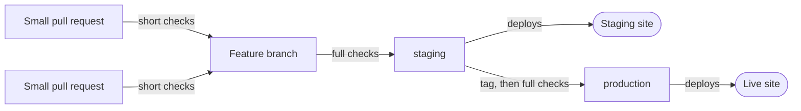
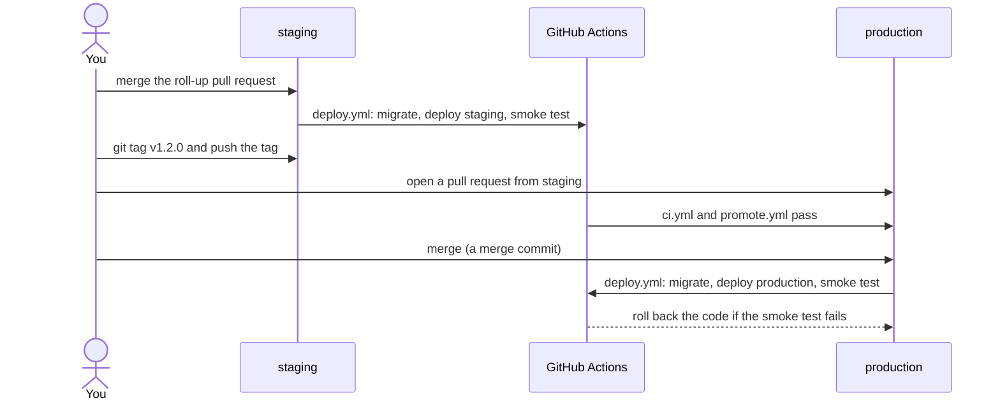
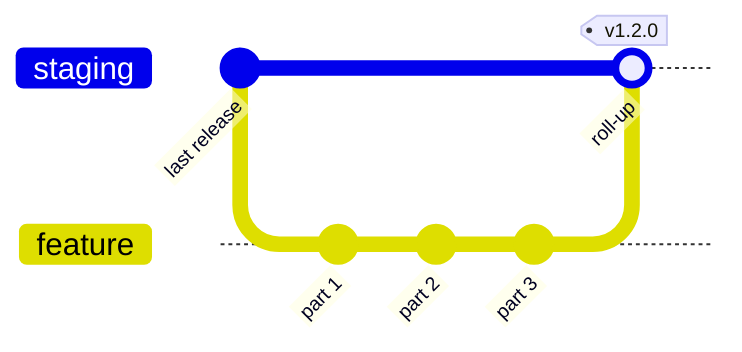

# Branches and releases

How code gets from your machine to production, and what stops a bad change on the way.

## The short version

- **`staging`** is the default branch. Every merge into it deploys the staging site.
- **`production`** deploys the live site. It moves only by a pull request from `staging` whose last
  commit has a version tag and has already passed its own staging deploy.
- **Small pull requests stack on each other** and get short checks. The pull request that rolls a
  stack up into `staging` gets the full checks.



## Which checks run where

| A pull request into | Workflow      | What runs                                                                                           |
| ------------------- | ------------- | --------------------------------------------------------------------------------------------------- |
| any other branch    | `pr.yml`      | Lint, types, unit tests, dead code, a scan for keys                                                 |
| `staging`           | `ci.yml`      | All of the above, plus the build, size budgets, `bun audit`, the migration check, e2e, the timeline |
| `production`        | `ci.yml`      | The same checks again, on the merge result                                                          |
| `production`        | `promote.yml` | The pull request comes from `staging`, and its last commit has a `v*` tag                           |

A push to `staging` also runs `ci.yml` and `deploy.yml`.

The short checks take a few minutes and catch most mistakes. The slow ones (a real browser, the
size of every page) run once, on the change that will ship.

## The first deploy

The `create` wizard offers to do all of this when it makes the project. It sets up Cloudflare,
migrates each environment's database, and deploys staging and production once, so each Worker exists
with its bindings and its address is known. Then it creates the GitHub repository and hands it the
deploy settings before the first push, so that push deploys staging again through CI. If you skipped
a step, or need it again after adding a feature, these are the same steps as commands, in this
order:

```bash
bunx create-tanstack-cf-saas setup    # D1, KV, R2, migrations, secrets and a first deploy, for both environments
bunx create-tanstack-cf-saas github                                       # repository, branches, rules, deploy settings
```

The last one gives GitHub Actions what `deploy.yml` reads:

| Setting                 | Kind     | Where the value comes from                                   |
| ----------------------- | -------- | ------------------------------------------------------------ |
| `CLOUDFLARE_ACCOUNT_ID` | variable | `wrangler login`, when you have one account; else your shell |
| `STAGING_URL`           | variable | staging's `APP_URL`, which `setup` writes after it deploys   |
| `PRODUCTION_URL`        | variable | production's `APP_URL`                                       |
| `CLOUDFLARE_API_TOKEN`  | secret   | you type it once; it goes to GitHub and nowhere else         |

Make the token in the Cloudflare dashboard (My Profile → API Tokens → the "Edit Cloudflare
Workers" template, plus D1 edit if you use the database). The command names anything it could not
work out and how to supply it. Until the account id is set, both deploy jobs skip and say nothing.

## Ship a release



```bash
git fetch origin
git tag v1.2.0 origin/staging && git push origin v1.2.0
gh pr create --base production --head staging --title "Release v1.2.0"
```

Tag first, then open the pull request. If you tag late, re-run the `promote` job.

## The rules, and why each is there

The rules are files: `.github/rulesets/staging.json` and `production.json`. Apply them with
`bunx create-tanstack-cf-saas github`, and run it again after you change one. GitHub can also
import them by hand (Settings → Rules → Rulesets → Import).

| Rule                                 | On                      | Why                                                                                                 |
| ------------------------------------ | ----------------------- | --------------------------------------------------------------------------------------------------- |
| Changes come by pull request         | `staging`, `production` | Nothing reaches a deploy branch without its checks.                                                 |
| No force push, no delete             | `staging`, `production` | History that has been deployed stays.                                                               |
| `check`, `secrets`, `e2e` must pass  | `staging`, `production` | The full checks in `ci.yml`.                                                                        |
| `timeline` must pass                 | `staging`               | Every changed feature gets a line in its `TIMELINE.md`.                                             |
| `promote` must pass                  | `production`            | Only `staging` merges in, and only at a tagged commit: the tag names what you shipped.              |
| `staging` (the deploy job) must pass | `production`            | The commit you promote has already been migrated, deployed and smoke-tested on staging.             |
| Merge commits only                   | `production`            | A squash would give `production` a commit `staging` never had, and the next release would conflict. |

No rule asks for an approving review, so one person can run the whole flow. Add reviewers in the
ruleset file when the team grows.

## Stacked pull requests

Split a big change into small pull requests, each based on the one before it. Reviews stay short
and each one gets the short checks in minutes.



When a stacked pull request's parent merges and its branch is deleted, GitHub points the child at
`staging`. That starts no checks by itself. Push to the child (the rebase you do after a squash
merge is a push) or close and reopen it, and the full checks run.

## Things that will surprise you once

- **A check that never ran shows as "Expected".** That is the retarget case above. Push or reopen.
- **`promote` fails with "No version tag".** Tag the commit at the tip of `staging`, push the tag,
  re-run the job. A new merge into `staging` after you tagged moves the tip: tag again.
- **A hotfix goes through `staging` too.** There is no side door into `production`. Merge the fix
  into `staging`, tag, promote.
- **Rules on a private repository need a paid GitHub plan.** On a free plan the `github` command
  creates the repository and both branches, then stops at the rules with GitHub's own message.
- **Production is deployed once by hand, at setup.** That first deploy gives it an address. After
  it, production moves only by a promotion; creating the `production` branch deploys nothing.
- **A failed production smoke test rolls back the code, not the database.** Keep migrations
  additive; `docs/runbook.md` says what to do next.

## Why a skipped job is dangerous here

GitHub counts a job that was skipped by an `if` as passed. A push to `staging` runs `ci.yml` on the
same commit a promotion starts from. If the tag gate lived in `ci.yml` with
`if: base is production`, the push run would mark it skipped, and the promotion would show it green
before it ran. So `promote.yml` stands alone, runs only on pull requests into `production`, and
has no `if`. `timeline` skips on a push for the same reason, which is why `production` does not
require it. `runbook.test.ts` fails if either drifts.

## Add your own workflows

Put them beside the four in `.github/workflows/`. To make a new job a required check, add its name
to the ruleset file and run `github` again. Never require a job that an `if` can skip.
