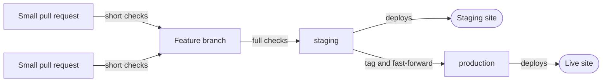
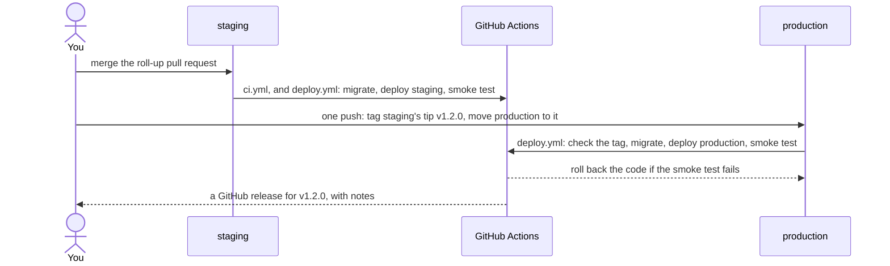
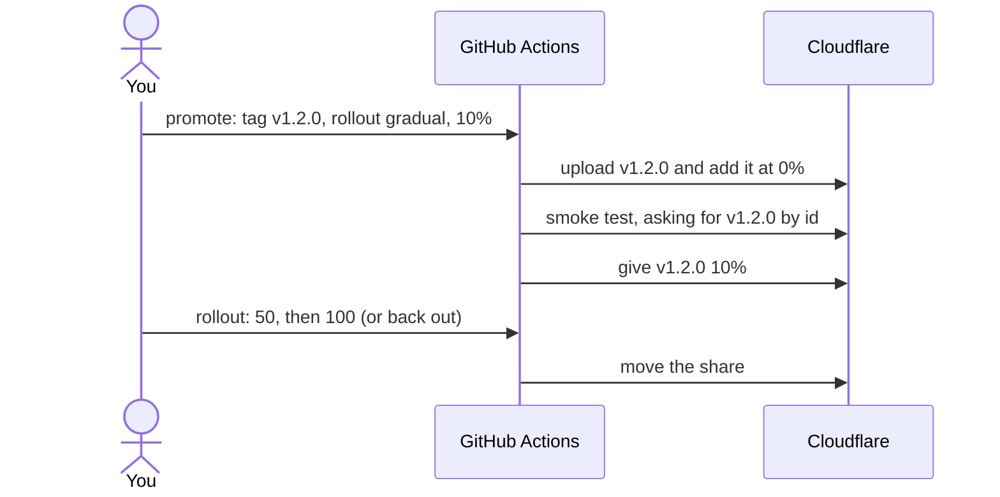
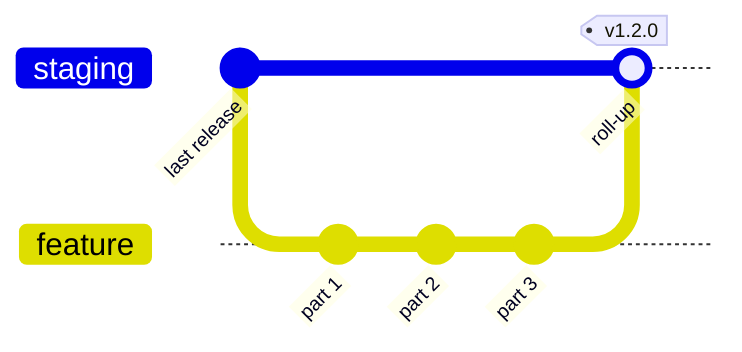

# Branches and releases

How code gets from your machine to production, and what stops a bad change on the way.

## The short version

- **`staging`** is the default branch. Every merge into it deploys the staging site.
- **`production`** deploys the live site. It gets no pull requests and no commits of its own: a
  release tags `staging`'s tip and moves `production` to that same commit, so both branches share
  one head. The commit must have passed its checks and its own staging deploy.
- **Small pull requests stack on each other** and get short checks. The pull request that rolls a
  stack up into `staging` gets the full checks.



## Which checks run where

| A pull request into | Workflow | What runs                                                                                           |
| ------------------- | -------- | --------------------------------------------------------------------------------------------------- |
| any other branch    | `pr.yml` | Lint, types, unit tests, dead code, a scan for keys                                                 |
| `staging`           | `ci.yml` | All of the above, plus the build, size budgets, `bun audit`, the migration check, e2e, the timeline |

A push to `staging` also runs `ci.yml` and `deploy.yml`. `production` runs no checks of its own: it
takes a commit only after these passed on it. Before `deploy.yml` deploys production, it checks
that the commit is on `staging` and has a `v*` tag.

The short checks take a few minutes and catch most mistakes. The slow ones (a real browser, the
size of every page) run once, on the change that will ship.

## The first deploy

The `create` wizard offers to do all of this when it makes the project. It sets up Cloudflare,
migrates each environment's database, and deploys staging and production once, so each Worker exists
with its bindings and its address is known. Then it creates the GitHub repository and hands it the
deploy settings before the first push, so that push deploys staging again through CI. If you skipped
a step, or need it again after adding a feature, these are the same steps as commands, in this
order:

```bash
bun run setup                         # D1, KV, R2, migrations, secrets and a first deploy, for both environments
bunx create-software-factory github   # repository, branches, rules, deploy settings
```

The last one gives GitHub Actions what `deploy.yml` reads:

| Setting                 | Kind     | Where the value comes from                                   |
| ----------------------- | -------- | ------------------------------------------------------------ |
| `CLOUDFLARE_ACCOUNT_ID` | variable | `wrangler login`, when you have one account; else your shell |
| `STAGING_URL`           | variable | staging's `APP_URL`, which `setup` writes after it deploys   |
| `PRODUCTION_URL`        | variable | production's `APP_URL`                                       |
| `CLOUDFLARE_API_TOKEN`  | secret   | you type it once; it goes to GitHub and nowhere else         |

Make the token in the Cloudflare dashboard (My Profile → API Tokens → the "Edit Cloudflare
Workers" template, plus D1 edit if you use the database). The command names anything it could not
work out and how to supply it. Until the account id is set, both deploy jobs skip and say nothing.

## Move to your own domain

On `workers.dev` production can only release `full`: a gradual rollout needs the rule in
[It needs a custom domain and one rule](#it-needs-a-custom-domain-and-one-rule), and that rule
needs a domain. Once the domain is on Cloudflare, add it to `wrangler.jsonc` as a route
(`"routes": [{ "pattern": "example.com", "custom_domain": true }]`). In the same change, give
`env.staging` its own `"routes": []`: an environment inherits the top-level routes, and staging
deploys first, so without that line it takes the domain. Then run one command:

```bash
bunx create-software-factory setup --env production --var APP_URL=https://example.com
```

It writes the URL as production's `APP_URL` and sets `PRODUCTION_URL` on GitHub. When your
checkout is `staging`'s tip, changed only in `wrangler.jsonc`, it also deploys under the new URL;
otherwise the next promotion does. Run plain `setup` at a terminal and it asks for each environment's URL instead. Merge
the changed `wrangler.jsonc` into `staging` before the next promotion: `promote.yml` and
`deploy.yml` refuse to start while `PRODUCTION_URL` and production's `APP_URL` there differ,
because `/api/health` answers 503 under any URL but `APP_URL`, and the smoke test would roll the
release back.

A variable changed only in the Cloudflare dashboard lasts until the next deploy from CI, which
writes back what `wrangler.jsonc` holds.

## Ship a release



```bash
git fetch origin
git push --atomic origin origin/staging:refs/tags/v1.2.0 origin/staging:refs/heads/production
```

The one push makes the tag and moves `production` to the commit `staging` is on, or does neither.
It adds no commit, so nothing merges and the tag names exactly what is live. Never add `--force`.

The same release is a button: on GitHub, Actions → promote → Run workflow, and type the tag.
`promote.yml` makes that one push from `staging`'s tip, under the same rules, then starts
`deploy.yml` on `production` itself, because a push made by a workflow starts no other workflow.

Either way, each promoted tag gets a GitHub release. Once the smoke test has passed, `deploy.yml`
creates it for the tag, with notes GitHub writes from the pull requests merged since the last
release. A release that fails its smoke test gets no release page, and the next release's notes
list its changes. A gradual rollout gets its page with its first share and keeps it if you back
out later: nothing deletes a release. To remove one by hand, run `gh release delete v1.2.0`.

If GitHub cannot make the release, the deploy still passes, and the run shows a warning with the
command to make it by hand.

## Roll a release out to a share of visitors

The promote button has a second choice, **rollout**. `full` gives every visitor the release at
once. `gradual` gives it to a share of them, 10% unless you say otherwise, and leaves the old
version serving the rest until you move the share.



1. **Start it.** Actions → promote → Run workflow, with the tag, `gradual` and a percent.
   `deploy.yml` uploads the new version and adds it to production with no visitors on it. The smoke
   test asks for that version by id and checks `/api/health` answers from it. Only then does it
   get its share. A failed smoke test takes it out again; no visitor saw it.
2. **Watch it.** Compare the two versions before you move on (see below).
3. **Move it.** Actions → rollout → Run workflow: `25`, `50`, `75`, `100`, or `back out`, which
   returns every visitor to the old version. At `100` or `back out` the rollout is over.

### Where to see it

| Where                                            | What it shows                                           |
| ------------------------------------------------ | ------------------------------------------------------- |
| The summary of each `deploy` or `rollout` run    | Each live version's id and its share, after the step    |
| Cloudflare dashboard → your Worker → Deployments | The live split, and its history                         |
| `/api/health`                                    | `version`: the id and tag of the version that answered  |
| PostHog, with `ANALYTICS_PROVIDER=posthog`       | `app_version` on every event: the tag, such as `v1.2.0` |

Staging's events carry `staging-` and the commit, such as `staging-1a2b3c4`; a deploy by hand has
no tag and sends the version's id.

In PostHog, break any chart down by `app_version` to compare the two versions: errors, sign-ups,
web vitals. To mark each step on the same timeline, give GitHub the project key:

```bash
gh secret set POSTHOG_KEY          # the same key the Worker has
gh variable set POSTHOG_HOST --body https://eu.i.posthog.com   # only if you are not on the US host
```

Each deploy and each rollout step then posts a `deployment_rolled_out` event with `app_version`
and `percent`. Without the secret, nothing is sent.

### It needs a custom domain and one rule

Cloudflare picks a version for each request on its own. Without help, a page from the new
version asks the old one for a script it never had, and the page breaks. One rule on your domain
pins each visitor to one version.

`deploy.yml` makes that rule before a gradual rollout starts, if its token may. Give
`CLOUDFLARE_API_TOKEN` two more permissions on the domain: Zone → Zone → Read and Zone → Transform
Rules → Edit. The rule covers your app's host only and leaves the domain's other rules alone.

Or make it by hand. In the Cloudflare dashboard, on the domain: Rules → Transform Rules → Modify
Request Header → Create rule.

| Field       | Value                            |
| ----------- | -------------------------------- |
| When        | All incoming requests            |
| Then        | Set dynamic                      |
| Header name | `Cloudflare-Workers-Version-Key` |
| Value       | `ip.src`                         |

Visitors behind one address then share a version, and one who changes network may switch once.
That rule cannot run on `workers.dev`, so `deploy.yml` refuses a gradual rollout there. On a
custom domain it also tests the outcome, whoever made the rule: once the new version has its
share, it calls `/api/health` a hundred times, and backs out if two versions answer. Start at 5%
or more, where that check can tell.

To move production to a domain first, see [Move to your own domain](#move-to-your-own-domain).

### What a gradual rollout cannot carry

- **A change to routes, cron triggers, Workflows or Durable Object classes.** Those belong to the
  whole Worker, not to one version, and Wrangler applies them only in a full deploy. Ship that
  release `full`.
- **A migration that the old version cannot live with.** Both versions read one database, for as
  long as the rollout runs. Keep migrations additive, as for any deploy.
- **A second rollout.** Two versions can share production, not three. Finish or back out first.

A `full` release is not held back by a running rollout: it takes all of production, and both
older versions stop serving.

## The rules, and why each is there

The rules are files: `.github/rulesets/staging.json` and `production.json`. Apply them with
`bunx create-software-factory github`, and run it again after you change one. GitHub can also
import them by hand (Settings → Rules → Rulesets → Import).

| Rule                                 | On                      | Why                                                                                              |
| ------------------------------------ | ----------------------- | ------------------------------------------------------------------------------------------------ |
| Changes come by pull request         | `staging`               | Nothing lands on `staging` without its checks.                                                   |
| No pull-request rule                 | `production`            | A merge would add a commit `staging` never had. A push of `staging`'s own commit keeps one head. |
| No force push, no delete             | `staging`, `production` | History that has been deployed stays.                                                            |
| `check`, `secrets`, `e2e` must pass  | `staging`, `production` | The full checks in `ci.yml`. `production` takes a commit only once they passed on it.            |
| `timeline` must pass                 | `staging`               | Every changed feature gets a line in its `TIMELINE.md`.                                          |
| `staging` (the deploy job) must pass | `production`            | The commit you promote has already been migrated, deployed and smoke-tested on staging.          |
| Squash merges only                   | `staging`               | One pull request is one commit on `staging`, named by the pull request's title.                  |
| `title` must pass                    | `staging`               | With the hooks, the title is a scoped conventional commit, like `fix(auth): expire sessions`.    |

One gate is not a rule, because a ruleset cannot ask for a tag. The production job in `deploy.yml`
starts by checking that the commit is on `staging` and has a `v*` tag, and deploys nothing
otherwise.

No rule asks for an approving review, so one person can run the whole flow. Add reviewers in the
ruleset file when the team grows.

## Stacked pull requests

Split a big change into small pull requests, each based on the one before it. Reviews stay short
and each one gets the short checks in minutes.



When a stacked pull request's parent merges and its branch is deleted, GitHub points the child at
`staging`. That starts no checks by itself. Push to the child (the rebase you do after a squash
merge is a push) or close and reopen it, and the full checks run.

## Things that will surprise you once

- **A check that never ran shows as "Expected".** That is the retarget case above. Push or reopen.
- **GitHub refuses the release push.** A required check has not passed on `staging`'s tip yet, the
  staging deploy included. Wait for it, then push again. No tag was made.
- **The production deploy fails at "On staging, with a version tag".** `production` moved without
  a tag. The error prints the command that tags the commit; run it, then re-run the job.
- **Never merge a pull request into `production`.** It adds a commit `staging` lacks, which
  `deploy.yml` will not deploy, and the release push then fails as "non-fast-forward". To mend it,
  turn off "Restrict deletions" in the `production` ruleset, delete the branch, and run
  `bunx create-software-factory github`: it makes the branch again from `staging` and puts the
  rule back.
- **A hotfix goes through `staging` too.** There is no side door into `production`. Merge the fix
  into `staging`, then release.
- **Rules on a private repository need a paid GitHub plan.** On a free plan the `github` command
  creates the repository and both branches, then stops at the rules with GitHub's own message.
- **Production is deployed once by hand, at setup.** That first deploy gives it an address. After
  it, production moves only by a promotion; creating the `production` branch deploys nothing.
- **A gradual rollout that `deploy.yml` refuses has still moved `production`.** The button checks
  the percent and the domain before it pushes, but only the deploy can see that another rollout
  is running. Finish that one or back out, then start the deploy again: Actions → deploy → Run
  workflow, on `production`.
- **The rollout button says no rollout is running.** One version serves everything: the last
  release went out `full`, or the rollout already reached `100` or backed out.
- **A failed production smoke test rolls back the code, not the database.** Keep migrations
  additive; `docs/runbook.md` says what to do next.

## Why a skipped job is dangerous here

GitHub counts a job that was skipped by an `if` as passed. `production` reads its required checks
from the push to `staging` that a release starts from, and `timeline` skips on a push, so
requiring it there would prove nothing: `production` does not. The tag gate is a step inside the
production deploy job, not a job of its own, so it cannot pass by skipping: when the job skips,
nothing deploys. `runbook.test.ts` fails if either drifts.

## Add your own workflows

Put them beside the six in `.github/workflows/`. To make a new job a required check, add its name
to the ruleset file and run `github` again. Never require a job that an `if` can skip.
