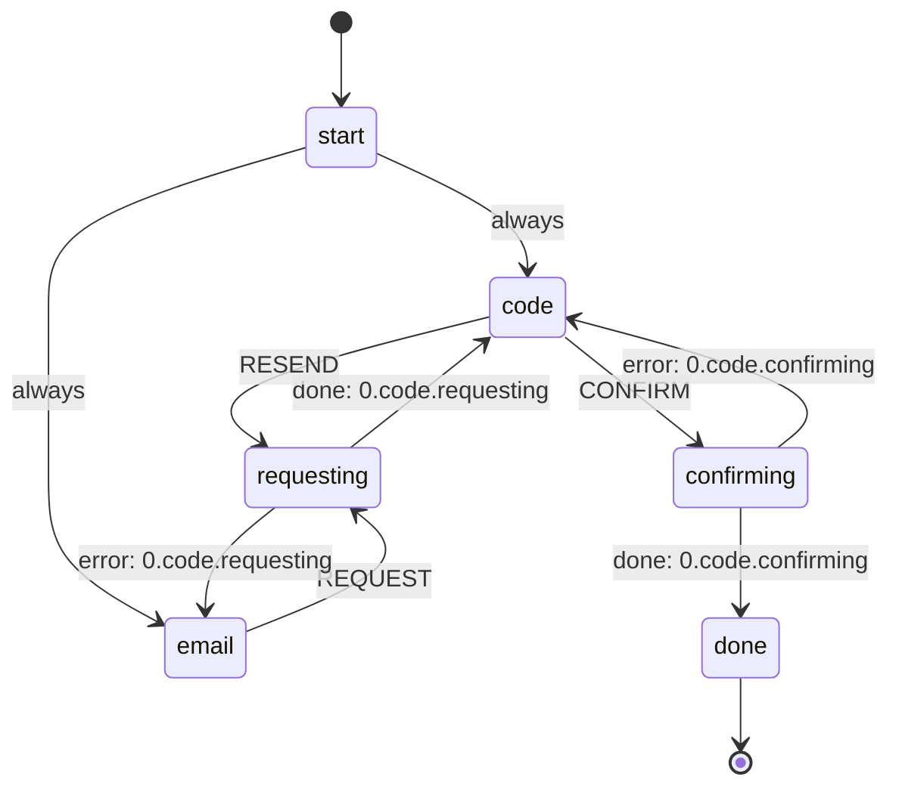

<!-- generated:start -->
<!-- Written by `cf-saas-blocks sync` from feature.json and the source. Edits here are lost. -->

# Auth emails (`auth-email`)

What auth does with email, through Better Auth's emailOTP plugin: a code to verify the address at sign-up, to reset a password, and to sign in without one.

- Kind: feature, auto; on whenever auth and email are, and removed with either
- Depends on: [auth](../auth/TIMELINE.md), [email](../core/email/TIMELINE.md)
- Used by: none
- Bindings: none
- Vars: none
- Secrets: none
- Also owns: none
- Feeds: `src/gen/nav.ts`, `src/gen/auth-plugins.ts`, `src/gen/routes.ts`
- Routes: `/forgot-password`, `/sign-in-code`, `/verify-email`
- Services: none
- Errors: none
- Events: none
- Machines: `components/code.machine.ts`. Diagrams under Machines, from `bun run machines:print`.
<!-- generated:end -->

<!-- machines:start -->

## Machines

Written by `bun run machines:print`. `bun run test` fails when a diagram is out of date.

### code

Source: `src/features/auth-email/components/code.machine.ts`

<!-- machines:end -->

## Decisions

<!-- Newest first, one line each: - YYYY-MM-DD — <decision>. Why: <reason>. (<commit sha or PR URL>) -->

- 2026-11-27 — An `auto` feature: nobody chooses it; it is on exactly when `auth` and `email` both are, and leaves with either. Why: auth must work without email and email without auth, and auth can't import a module that may be absent.
- 2026-11-27 — Everything goes through Better Auth's `emailOTP` plugin, added from `auth-plugins.ts`: a 6-digit code verifies the address at sign-up, resets a password and signs in. No links. Why: one plugin covers all three, and a code leaves no token in a URL, a browser history or a server log.
- 2026-11-27 — With this feature on, sign-in waits for a verified address (`requireEmailVerification`, set by the `require-verified-email` plugin's `init`), and a sign-in before that sends a fresh code. Why: nobody should hold an account under an address they don't own.
- 2026-11-27 — The plugins stay off until the `EMAIL` binding and `EMAIL_FROM` are both set; auth then works as it does without email. Why: requiring a verified address with no way to send the code would lock everyone out.
- 2026-11-27 — A code for an address with no account sends nothing and makes no account (`disableSignUp`), and the page says the same thing either way. Why: sign-up has a Turnstile check a code would skip, and the answer must not reveal who has an account.
- 2026-11-27 — Codes are stored hashed, last 5 minutes and allow 3 tries; the code paths are in auth's `CODE_PATHS`, limited per address like sign-in. Why: a 6-digit code is guessable without a cap, and each request sends a mail.
- 2026-11-27 — The three pages share one `code` machine and form. Why: each is "give an email, get a code, confirm it"; only the last call differs.
- 2026-11-27 — Auth's pages find these through `nav.ts` entries marked `sign-in-help` and `verify-email`. Why: the login and sign-up pages belong to auth, which can't import this feature.

## History

<!-- Newest first, one line each: - YYYY-MM-DD — <what changed>. (<commit sha or PR URL>) -->
