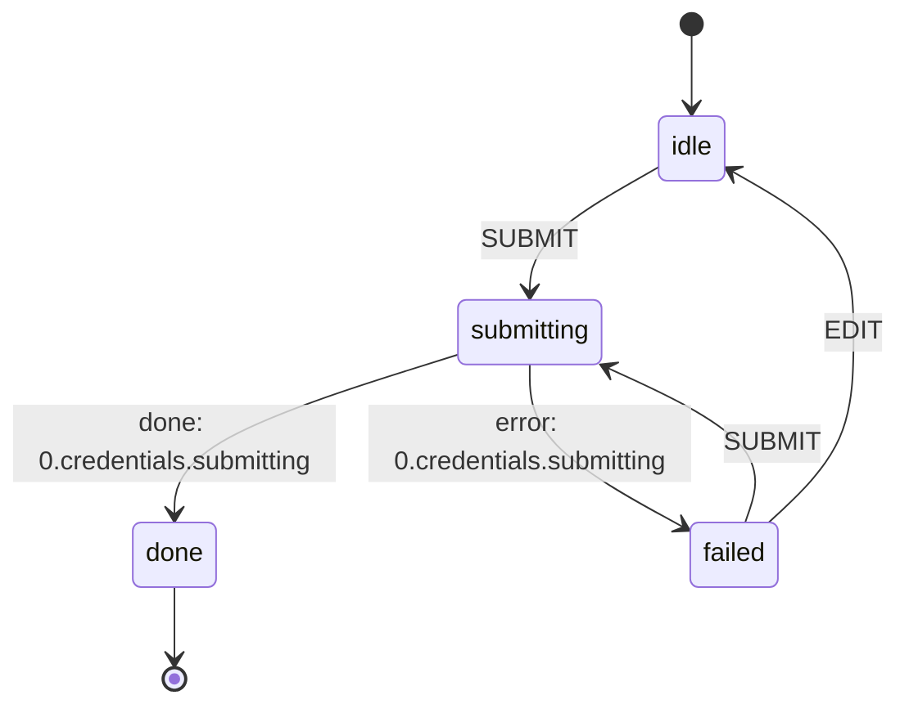

<!-- generated:start -->
<!-- Written by `cf-saas-blocks sync` from feature.json and the source. Edits here are lost. -->

# Auth (`auth`)

Better Auth with email and password, sessions in D1, rate-limited sign-in and sign-up.

- Kind: feature, optional; `cf-saas-blocks remove auth` takes it out
- Depends on: [db](../core/db/TIMELINE.md)
- Used by: [billing](../billing/TIMELINE.md), [uploads](../uploads/TIMELINE.md)
- Bindings: `AUTH_LIMITER` (ratelimit)
- Vars: `APP_URL` (required), `TRUSTED_ORIGINS`, `TURNSTILE_SITE_KEY`
- Secrets: `BETTER_AUTH_SECRET` (required), `TURNSTILE_SECRET_KEY`
- Also owns: none
- Feeds: `src/gen/layers.ts`, `src/gen/errors.ts`, `src/gen/events.ts`, `src/gen/nav.ts`, `src/gen/viewer.ts`, `src/gen/routes.ts`
- Routes: `/api/auth/$`, `/dashboard`, `/login`, `/signup`
- Services: `Auth`, `AuthRateLimiter`
- Errors: `AuthServiceError`
- Events: `sign_in_failed`, `sign_in_succeeded`, `sign_up_completed`, `signed_out`
- Machines: `components/credentials.machine.ts`. Diagrams under Machines, from `bun run machines:print`.
<!-- generated:end -->

<!-- machines:start -->

## Machines

Written by `bun run machines:print`. `bun run test` fails when a diagram is out of date.

### credentials

Source: `src/features/auth/components/credentials.machine.ts`

<!-- machines:end -->

## Decisions

<!-- Newest first, one line each: - YYYY-MM-DD — <decision>. Why: <reason>. (<commit sha or PR URL>) -->

- 2026-11-24 — Sign-up needs a Cloudflare Turnstile token when `TURNSTILE_SITE_KEY` and `TURNSTILE_SECRET_KEY` are both set (Better Auth's `captcha` plugin, `/sign-up/email` only); with either missing, sign-up is as before. Sign-in asks for a token only past its account's limit (`Auth.admit`, recorded as `sign_in_failed` with reason `challenged`); without Turnstile that is a 429 as before. Why: the rate limit slows one address but not a bot farm making accounts, while sign-in has the rate limit and a bot gains nothing from it; but anyone can spend an account's limit with wrong passwords, so refusing past it would let a stranger lock its owner out. `.dev.vars.example` carries Cloudflare's always-pass test keys so dev and the browser specs run guarded; `wrangler.jsonc` and the deployed secrets start empty, and the plugin logs a warning when it sees the test secret on a non-local `APP_URL`.
- 2026-11-24 — The audit log lives in auth, as `audit_log` beside Better Auth's tables, and every auth and billing outcome goes to both analytics and the log; `user_identified` goes to analytics only. Why: only auth knows who the actor is, and billing and uploads already require auth; a separate core module would need auth to require it.
- 2026-11-24 — A failed audit write is logged as a warning with `audit: true` and the request goes on. Why: a lost audit row is better than a user who cannot sign in.
- 2026-11-24 — A sign-in the rate limiter blocks goes to analytics only, not the audit log. Why: one row per blocked attempt would let a flood grow the table.
- 2026-11-24 — Sign-up or sign-in with an anonymous id sends `user_identified`, and sign-up, sign-in and sign-out all clear the id cookie. Why: earlier visits join the account, and an id is never tied to two users on a shared browser.
- 2026-11-24 — Before launch, wire a mail hook: email verification and password reset do not work yet. Set `sendResetPassword` under `emailAndPassword`, `sendVerificationEmail` under `emailVerification`, and `requireEmailVerification: true` in `api/auth.ts`, then add `/api/auth/request-password-reset` back to `LIMITED_PATHS`. Why: no sender is wired, so anyone can sign up with an address they don't own and nobody can reset a password.
- 2026-11-24 — The rate-limited paths are `LIMITED_PATHS` in `api/rate-limit.ts`: sign-in, sign-up and the Stripe subscription calls, through the shared `checkLimit` in `core/lib/rate-limit.ts`; `request-password-reset` joins them once a reset sender exists. Why: these take a password, make an account or spend the Stripe quota the whole account shares, and limiting a route that sends nothing would imply resets work.
- 2026-11-24 — An `APP_URL` without `http://` or `https://` degrades auth to `NotConfigured` naming `APP_URL (a full https:// URL)`. Why: `new URL` threw while the layer was built, so every route answered 500, not only auth.
- 2026-11-24 — A 429 carries a `retry-after` header from `RateLimited.retryAfterSeconds`, both from auth's handler and from `runResponse`. Why: clients had no way to know when to try again.
- 2026-11-24 — Email and password only, no social sign-in. Why: a provider nobody set up is dead weight; add one to `socialProviders` in `api/auth.ts` when you need it.
- 2026-11-24 — Better Auth's log lines go to the request's logger, and its errors to the error reporter, through the `logger.log` option; plugins get `loggedErrors()` to see them. Why: plugins such as Stripe's catch their own failures and only log them, so a console logger hid them from on-call.
- 2026-11-24 — After sign-in the page goes back with `navigate({ href })` and the `redirect` param must be a local path (`/` not followed by `/` or `\`). Why: as a `to`, a stored href with a search string became part of the path and showed Page not found.
- 2026-11-24 — The sign-in and sign-up form uses `method="post"`, and its button waits for hydration. Why: a submit before React loaded put the password in the URL, the browser history and the server log.
- 2026-11-24 — Without `BETTER_AUTH_SECRET` (32+ characters), `APP_URL` or the `DB` binding, Auth degrades: everyone is signed out and `/api/auth` answers 503 with `NotConfigured` naming the setting. Why: the rest of the app keeps working.
- 2026-11-24 — Better Auth's own rate limit is off; the `AUTH_LIMITER` binding limits `LIMITED_PATHS` per IP and path, and sign-in per account too, and a limiter outage lets requests through. Why: only a few paths need it, and an outage must not lock everyone out.
- 2026-11-24 — Auth analytics events come from Better Auth's response on the server, not from the form. Why: only the server knows for certain what happened.
- 2026-11-24 — Other features extend Better Auth through their `auth-plugins.ts`, gathered into `src/gen/auth-plugins.ts`; plugins queue events and warnings that flush with the request. Why: billing adds Stripe without auth importing billing.
- 2026-11-24 — `ensureSignedIn` only decides what a page renders; server functions check the session themselves. Why: a redirect is not a security check.

## History

<!-- Newest first, one line each: - YYYY-MM-DD — <what changed>. (<commit sha or PR URL>) -->
