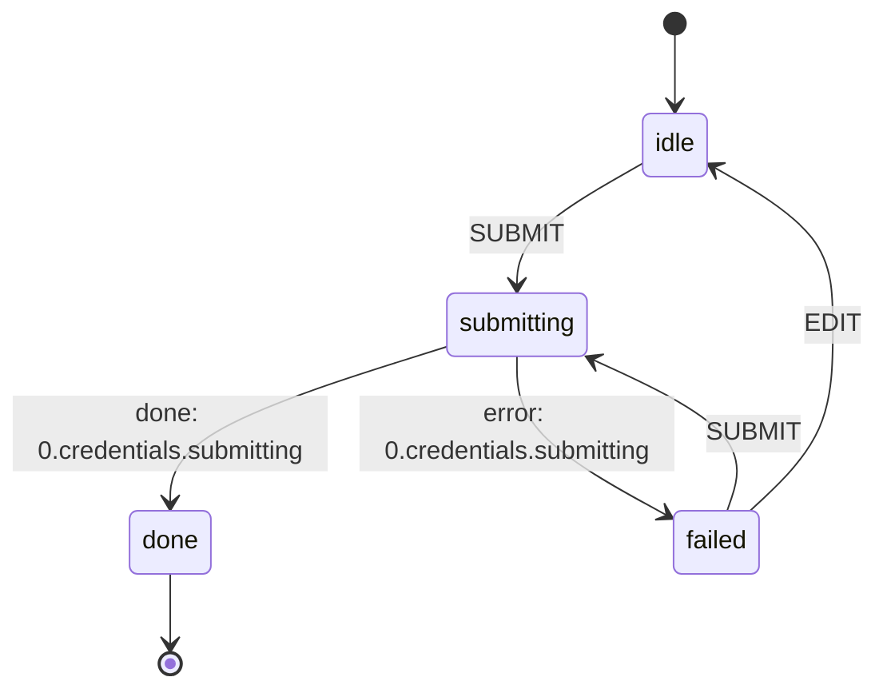

<!-- generated:start -->
<!-- Written by `cf-saas-blocks sync` from feature.json and the source. Edits here are lost. -->

# Auth (`auth`)

Better Auth with email and password, sessions in D1, rate-limited sign-in and sign-up.

- Kind: feature, optional; `cf-saas-blocks remove auth` takes it out
- Depends on: [db](../core/db/TIMELINE.md)
- Used by: [billing](../billing/TIMELINE.md), [uploads](../uploads/TIMELINE.md)
- Bindings: `AUTH_LIMITER` (ratelimit)
- Vars: `APP_URL` (required), `TRUSTED_ORIGINS`
- Secrets: `BETTER_AUTH_SECRET` (required)
- Also owns: none
- Feeds: `src/gen/layers.ts`, `src/gen/errors.ts`, `src/gen/events.ts`, `src/gen/nav.ts`, `src/gen/viewer.ts`, `src/gen/routes.ts`
- Routes: `/api/auth/$`, `/dashboard`, `/login`, `/signup`
- Services: `Auth`, `AuthRateLimiter`
- Errors: `AuthServiceError`
- Events: `sign_in_failed`, `sign_in_succeeded`, `sign_up_completed`, `signed_out`
- Machines: `components/credentials.machine.ts`. Diagrams under Machines, from `bun run machines:print`.
<!-- generated:end -->

<!-- machines:start -->

## Machines

Written by `bun run machines:print`. `bun run test` fails when a diagram is out of date.

### credentials

Source: `src/features/auth/components/credentials.machine.ts`

<!-- machines:end -->

## Decisions

<!-- Newest first, one line each: - YYYY-MM-DD — <decision>. Why: <reason>. (<commit sha or PR URL>) -->

- 2026-11-24 — The audit log lives in auth, as `audit_log` beside Better Auth's tables, and every event `Auth.handle` records goes to both analytics and the log. Why: only auth knows who the actor is, and billing and uploads already require auth; a separate core module would need auth to require it.
- 2026-11-24 — A failed audit write is logged as a warning with `audit: true` and the request goes on. Why: a lost audit row is better than a user who cannot sign in.
- 2026-11-24 — A sign-in the rate limiter blocks goes to analytics only, not the audit log. Why: one row per blocked attempt would let a flood grow the table.
- 2026-11-24 — Sign-up or sign-in with an anonymous id sends `user_identified`, and sign-up, sign-in and sign-out all clear the id cookie. Why: earlier visits join the account, and an id is never tied to two users on a shared browser.
- 2026-11-24 — Before launch, wire a mail hook: email verification and password reset do not work yet. Set `sendResetPassword` under `emailAndPassword`, `sendVerificationEmail` under `emailVerification`, and `requireEmailVerification: true` in `api/auth.ts`, then add `/api/auth/request-password-reset` back to `LIMITED_PATHS`. Why: no sender is wired, so anyone can sign up with an address they don't own and nobody can reset a password.
- 2026-11-24 — The limited paths are sign-in and sign-up only; `request-password-reset` is off the list until a reset sender exists. Why: limiting a route that sends nothing was dead code that implied resets worked.
- 2026-11-24 — An `APP_URL` without `http://` or `https://` degrades auth to `NotConfigured` naming `APP_URL (a full https:// URL)`. Why: `new URL` threw while the layer was built, so every route answered 500, not only auth.
- 2026-11-24 — A 429 carries a `retry-after` header from `RateLimited.retryAfterSeconds`, both from auth's handler and from `runResponse`. Why: clients had no way to know when to try again.
- 2026-11-24 — No GitHub sign-in: email and password only, so `GITHUB_CLIENT_ID` and `GITHUB_CLIENT_SECRET` are gone. Why: a provider nobody set up was dead weight; add one to `socialProviders` in `api/auth.ts` when you need it.
- 2026-11-24 — Better Auth's log lines go to the request's logger, and its errors to the error reporter, through the `logger.log` option; plugins get `loggedErrors()` to see them. Why: plugins such as Stripe's catch their own failures and only log them, so a console logger hid them from on-call.
- 2026-11-24 — A GitHub callback counts as `sign_in_succeeded` only when the response sets a session cookie. Why: Better Auth answers every OAuth failure with a redirect too, so a redirect status proved nothing.
- 2026-11-24 — After sign-in the page goes back with `navigate({ href })` and the `redirect` param must be a local path (`/` not followed by `/` or `\`). Why: as a `to`, a stored href with a search string became part of the path and showed Page not found.
- 2026-11-24 — The rate-limited paths are sign-in, sign-up and `request-password-reset`, through the shared fail-open `checkLimit` in `core/lib/rate-limit.ts`. Why: `forget-password` does not exist in Better Auth 1.7, so reset emails would have been unlimited once enabled.
- 2026-11-24 — The sign-in and sign-up form uses `method="post"`, and its button waits for hydration. Why: a submit before React loaded put the password in the URL, the browser history and the server log.
- 2026-11-24 — Without `BETTER_AUTH_SECRET` (32+ characters), `APP_URL` or the `DB` binding, Auth degrades: everyone is signed out and `/api/auth` answers 503 with `NotConfigured` naming the setting. Why: the rest of the app keeps working.
- 2026-11-24 — Better Auth's own rate limit is off; the `AUTH_LIMITER` binding limits sign-in, sign-up and forget-password per IP and path, and a limiter outage lets requests through. Why: only password paths need it, and an outage must not lock everyone out.
- 2026-11-24 — Auth analytics events come from Better Auth's response on the server, not from the form. Why: only the server knows for certain what happened.
- 2026-11-24 — Other features extend Better Auth through their `auth-plugins.ts`, gathered into `src/gen/auth-plugins.ts`; plugins queue events and warnings that flush with the request. Why: billing adds Stripe without auth importing billing.
- 2026-11-24 — `ensureSignedIn` only decides what a page renders; server functions check the session themselves. Why: a redirect is not a security check.

## History

<!-- Newest first, one line each: - YYYY-MM-DD — <what changed>. (<commit sha or PR URL>) -->

- 2026-11-24 — Every route has a spec: `e2e/<route>.route.spec.ts` for /login, /signup, /dashboard and /api/auth, each with a normal and an error case and (for pages) an axe scan.
- 2026-11-24 — Added `audit_log` (in `0000_init`), indexed on time, actor and action; `Auth.layerWith(factories)` for tests; plugins pass a user id with `onEvent`.
- 2026-11-24 — `metric` in `events.ts`: the share of sign-in attempts that succeed.
- 2026-11-24 — Added the indexes Better Auth's own schema asks for (`session.user_id`, `account.user_id`, `verification.identifier`) and `user.stripe_customer_id`, in migration `0001_indexes`.
- 2026-11-24 — Auth calls run through `outsideCall` and the rate limiter binding is read with `binding`, both from `core/lib`; imports db, analytics and ui from `src/features/core/`.
- 2026-11-24 — The path specs wait for an enabled button, give each test its own visitor IP so the sign-up limiter does not trip on a second run, and wait for sign-out before signing up again; `reaches submitting` now signs up for real. Added an SSR test for the form.
- 2026-11-24 — Moved into `src/features/auth/` from `src/blocks/auth/`, with pages from `src/routes/(auth)/` when the template switched from blocks to features.
