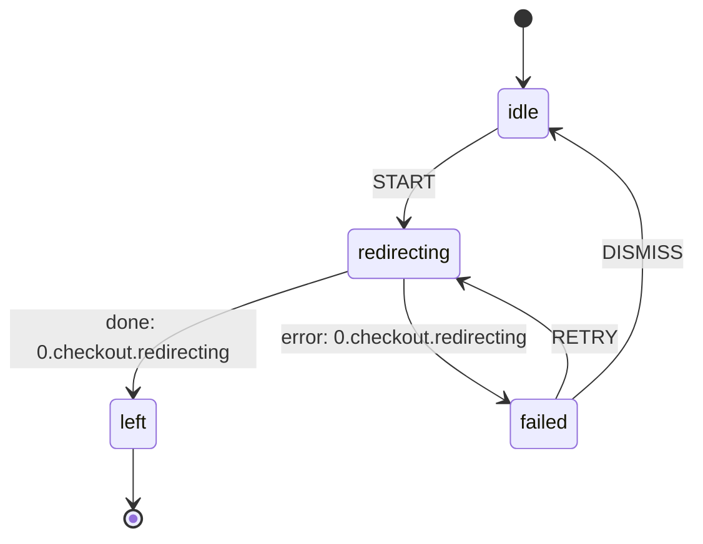
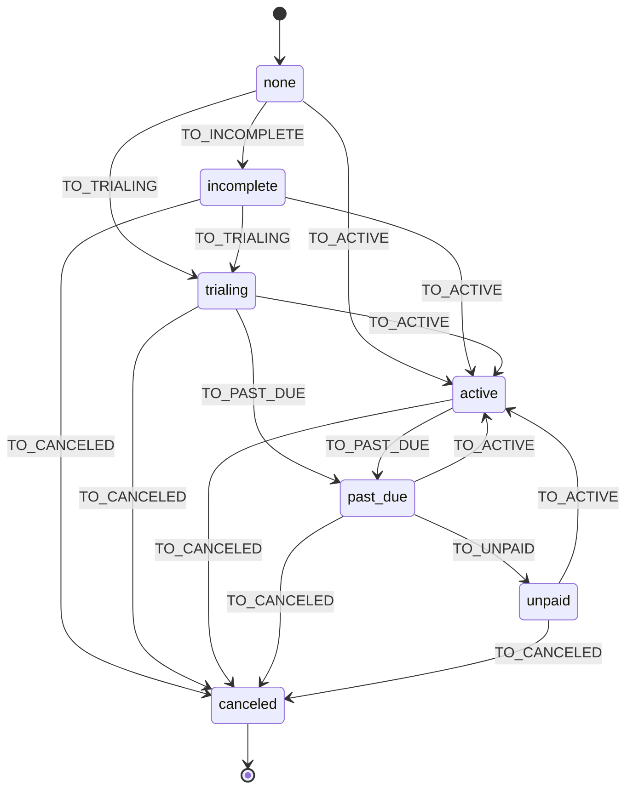

<!-- generated:start -->
<!-- Written by `cf-saas-blocks sync` from feature.json and the source. Edits here are lost. -->

# Billing (`billing`)

Stripe subscriptions through Better Auth's Stripe plugin: checkout, customer portal and webhooks.

- Kind: optional; `cf-saas-blocks remove billing` takes it out
- Depends on: [auth](../auth/TIMELINE.md)
- Used by: none
- Bindings: none
- Vars: `STRIPE_PRICE_PRO` (required)
- Secrets: `STRIPE_SECRET_KEY` (required), `STRIPE_WEBHOOK_SECRET` (required)
- Also owns: none
- Feeds: `src/gen/layers.ts`, `src/gen/events.ts`, `src/gen/nav.ts`, `src/gen/auth-plugins.ts`, `src/gen/routes.ts`
- Routes: `/billing`
- Services: `Billing`
- Errors: none
- Events: `checkout_started`, `subscription_activated`, `subscription_canceled`
- Machines: `components/checkout.machine.ts`, `machines/subscription.machine.ts`. Diagrams under Machines, from `bun run machines:print`.
<!-- generated:end -->

<!-- machines:start -->

## Machines

Written by `bun run machines:print`. `bun run test` fails when a diagram is out of date.

### checkout

Source: `src/features/billing/components/checkout.machine.ts`

### subscription

Source: `src/features/billing/machines/subscription.machine.ts`

<!-- machines:end -->

## Decisions

<!-- Newest first, one line each: - YYYY-MM-DD — <decision>. Why: <reason>. (<commit sha or PR URL>) -->

- 2026-11-24 — Without `STRIPE_SECRET_KEY` and `STRIPE_WEBHOOK_SECRET` the Stripe plugin is left out and `/billing` says what is missing. Why: the rest of the app works without Stripe.
- 2026-11-24 — The subscription lifecycle is a machine, and the `onSubscriptionUpdate` webhook handler checks each status change against it and logs the ones it did not expect. Why: Stripe stays the source of truth, so an odd change earns a warning, not a refusal.
- 2026-11-24 — A plan exists only when its Stripe price id is set (`STRIPE_PRICE_PRO`). Why: a plan without a price is left out, not broken.
- 2026-11-24 — The upgrade and manage button is the checkout machine; leaving for Stripe ends it, and a failure can be retried or dismissed. Why: every outcome of the button is a tested state.

## History

<!-- Newest first, one line each: - YYYY-MM-DD — <what changed>. (<commit sha or PR URL>) -->

- 2026-11-24 — Moved into `src/features/billing/` from `src/blocks/billing/`, with pages from `src/routes/(billing)/` when the template switched from blocks to features.
