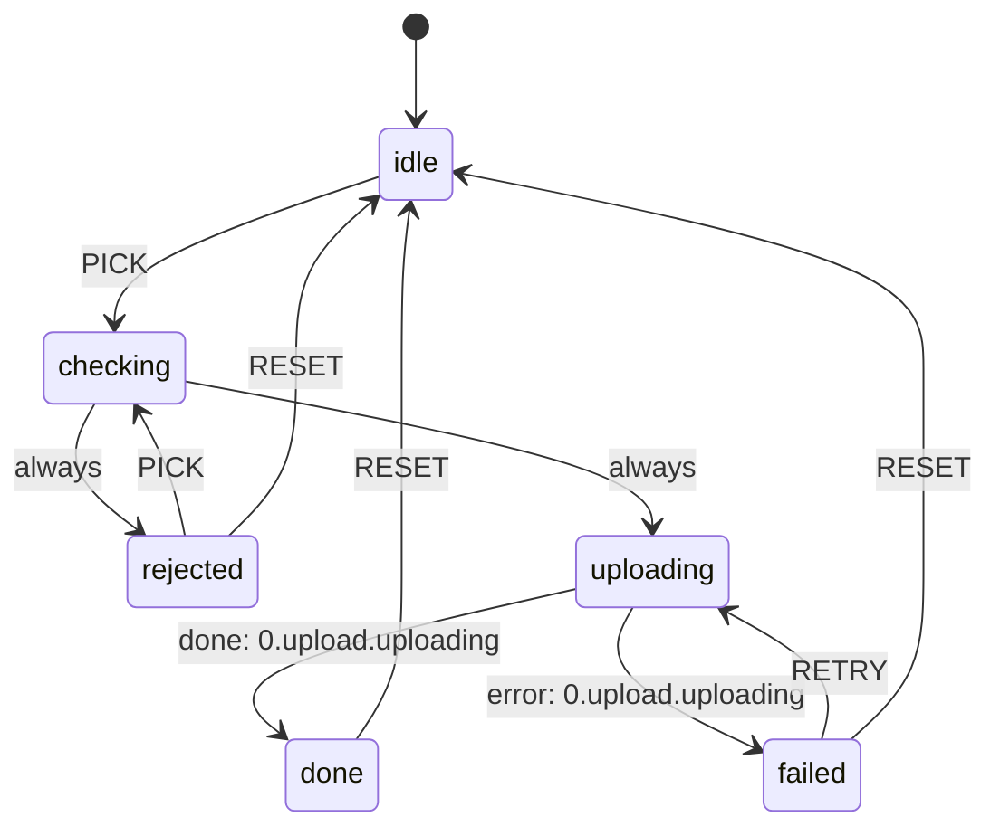

<!-- generated:start -->
<!-- Written by `cf-saas-blocks sync` from feature.json and the source. Edits here are lost. -->

# R2 uploads (`uploads`)

Per-user file uploads to R2 with size, type and magic-byte checks, a rate limit and an upload state machine.

- Kind: feature, optional; `cf-saas-blocks remove uploads` takes it out
- Depends on: [auth](../auth/TIMELINE.md)
- Used by: none
- Bindings: `BUCKET` (r2), `UPLOAD_LIMITER` (ratelimit)
- Vars: none
- Secrets: none
- Also owns: none
- Feeds: `src/gen/layers.ts`, `src/gen/errors.ts`, `src/gen/events.ts`, `src/gen/nav.ts`, `src/gen/routes.ts`
- Routes: `/api/uploads`, `/api/uploads/$id`, `/uploads`
- Services: `Uploads`
- Errors: `StorageError`, `UploadRejected`
- Events: `file_uploaded`
- Machines: `components/upload.machine.ts`. Diagrams under Machines, from `bun run machines:print`.
<!-- generated:end -->

<!-- machines:start -->

## Machines

Written by `bun run machines:print`. `bun run test` fails when a diagram is out of date.

### upload

Source: `src/features/uploads/components/upload.machine.ts`

<!-- machines:end -->

## Decisions

<!-- Newest first, one line each: - YYYY-MM-DD — <decision>. Why: <reason>. (<commit sha or PR URL>) -->

- 2026-11-24 — The server checks a file's first bytes against its declared type, not only the type the browser claims. Why: the declared type is whatever the client says.
- 2026-11-24 — The browser machine and the server run the same `check` from `lib/validate.ts`. Why: the user hears about a bad file before it uploads, and the server still has the last word.
- 2026-11-24 — Each user's files sit under `users/<id>/` with random keys. Why: one user can never name another's file.
- 2026-11-24 — Downloads go out as attachments with `nosniff`. Why: a stored file never renders as a page on our origin.
- 2026-11-24 — Without the `BUCKET` binding every call fails with `NotConfigured`; without `UPLOAD_LIMITER` uploads are not rate limited. Why: missing setup turns the feature off, not the app.
- 2026-11-24 — A request whose content-length passes 5 MB plus form overhead is refused before the form is read. Why: the Worker does not buffer an upload it will reject.

## History

<!-- Newest first, one line each: - YYYY-MM-DD — <what changed>. (<commit sha or PR URL>) -->

- 2026-11-24 — R2 calls run through `outsideCall` and the bindings are read with `binding`, both from `core/lib`; imports analytics and ui from `src/features/core/`.
- 2026-11-24 — The file picker stays disabled until hydration, and the spec waits for it, and for the dashboard, before it goes on.
- 2026-11-24 — Renamed from `r2` to `uploads` and moved into `src/features/uploads/` from `src/blocks/r2/` when the template switched from blocks to features.
